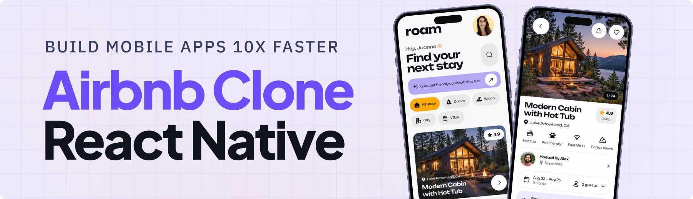

<div align="center">
  <br />
  
  <br />
  <br />

  <div>
    
    
    
    
    
  </div>

  <h1 align="center">Atithi | AI-Powered Vacation Rental App</h1>

  <p align="center">
    A modern Airbnb-style mobile vacation rental app for iOS and Android featuring natural-language search, grounded policy chat, interactive stay galleries, and a floating glass navigation bar.
  </p>
</div>

## 📋 <a name="table">Table of Contents</a>

1. ✨ [Introduction](#introduction)
2. ⚙️ [Tech Stack](#tech-stack)
3. 🔋 [Features](#features)
4. 🤸 [Quick Start](#quick-start)

## <a name="introduction">✨ Introduction</a>

**Atithi** is an Airbnb-style mobile application built for iOS and Android where guests skip rigid filters and dropdowns. Users describe what they actually want in plain English—such as *"a quiet cabin with a hot tub that allows dogs and costs under $300 a night"*—and receive ranked stay recommendations matching their intent.

Each property stay features high-resolution curated photography, clear pricing breakdowns, host profiles, and a built-in Q&A assistant that answers questions like *"can I bring my pet?"* directly from that stay's actual house rules and policies, ensuring every answer is factual and grounded.

## <a name="tech-stack">⚙️ Tech Stack</a>

- **[React Native](https://reactnative.dev/)**: Cross-platform native mobile application framework powering both iOS and Android.
- **[Expo](https://expo.dev/)**: Toolchain and platform providing file-based routing with Expo Router, assets, font management, and smooth developer workflow.
- **[TypeScript](https://www.typescriptlang.org/)**: Strongly typed foundation ensuring type safety, predictable state, and robust component architecture.
- **[NativeWind](https://www.nativewind.dev/) (Tailwind CSS v4)**: Utility-first styling engine mapped to a custom design token system.
- **[Clerk](https://clerk.com/)**: Complete authentication and user management platform providing secure custom sign-up, email verification, sign-in, and OAuth SSO.

## <a name="features">🔋 Features</a>

👉 **Natural-Language Search**: Search stays with free-form queries without needing complex filter menus.

👉 **Grounded Stay & Policy Chat**: Ask questions regarding pet rules, check-in, parking, or cancellation and receive answers pulled word-for-word from verified stay policies.

👉 **Vacation Rental REST API**: Fast, reliable property dataset delivering curated listings, high-resolution imagery, pricing, and amenities.

👉 **Floating Glass Tab Bar**: Frosted glass navigation dock with glowing active indicators, icons, and smooth transitions.

👉 **Interactive Photo Gallery**: Full-width swipeable property carousel with photo index indicators.

👉 **Authentication**: Custom authentication flows powered by Clerk including email verification and secure session persistence.

👉 **Favorites & Profile**: Save stays for quick reference and manage personal profile details.

## <a name="quick-start">🤸 Quick Start</a>

Follow these steps to set up the project locally on your machine.

### Prerequisites

Make sure you have the following installed on your machine:

- [Git](https://git-scm.com/)
- [Node.js](https://nodejs.org/) (v18 or higher recommended)
- [npm](https://www.npmjs.com/)

### Cloning the Repository

```bash
git clone https://github.com/raahul131/Atithi_.git
cd Atithi_
```

### Installation

Install the project dependencies using npm:

```bash
npm install
```

### Set Up Environment Variables

Create a new file named `.env.local` in the root of your project and configure your keys:

```env
EXPO_PUBLIC_CLERK_PUBLISHABLE_KEY=pk_test_...
CLERK_SECRET_KEY=sk_test_...
```

Sign up for credentials directly at [Clerk](https://clerk.com/).

### Running the Project

Start the Expo development server:

```bash
npx expo start
```

Press:
- `i` to open in the iOS Simulator (macOS with Xcode)
- `a` to open in the Android Emulator (with Android Studio)
- Scan the displayed QR code with the Expo Go app on your physical iOS or Android device.
